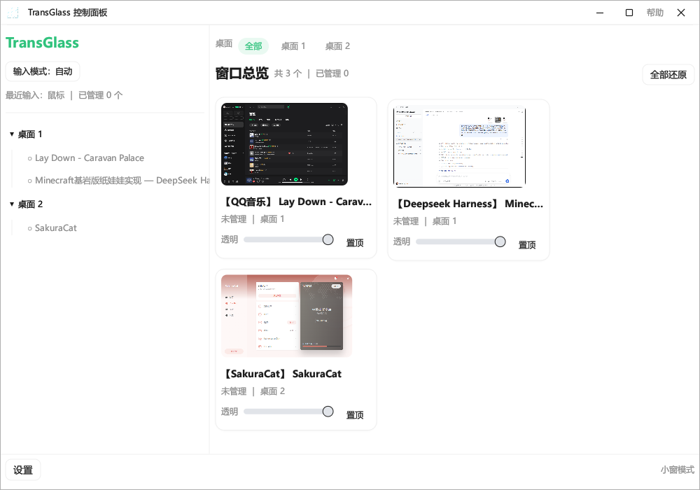
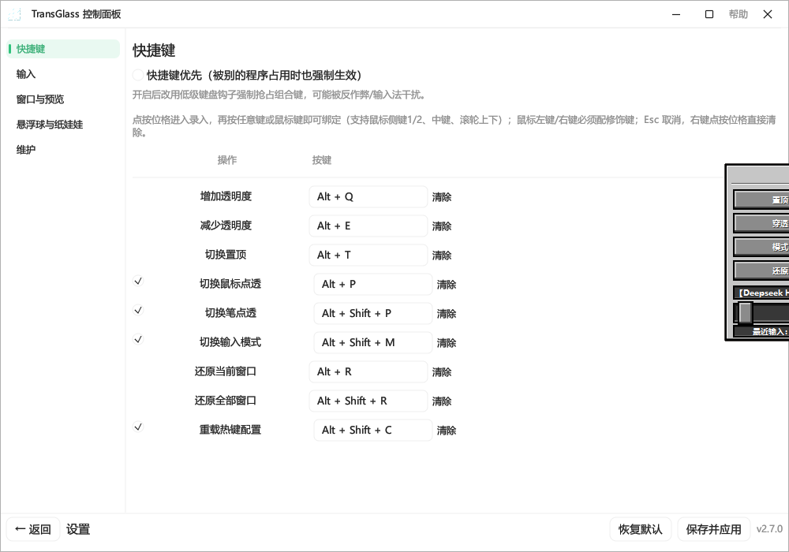

# TransGlass 使用教程

TransGlass 是一个 Windows 窗口透明化工具：给任意窗口做**逐窗透明度**、**鼠标/笔点透**、**置顶**，
再配一个 MC 风格的悬浮球当遥控器。

- 仓库：<https://github.com/railgun-1145/TransGlass>
- 下载：到 [Releases](https://github.com/railgun-1145/TransGlass/releases) 下最新的 `TransGlass_x.y.z_Setup.exe`

---

## 1. 安装

1. 双击 `TransGlass_<版本>_Setup.exe`
2. **安装位置可以自己改**（默认 `%LOCALAPPDATA%\Programs\TransGlass`，不需要管理员权限）
3. 可选：「开机自启」「创建桌面图标」
4. 装完自动启动，右下角托盘会出现一块**玻璃方块**图标

> 卸载：设置 → 应用 → TransGlass，或开始菜单里的卸载项。卸载会一并清掉开机自启项。

---

## 2. 主界面

左边是窗口列表（按虚拟桌面分组），右边是窗口卡片：

| 位置 | 作用 |
| :--- | :--- |
| 卡片标题 `【软件名】 窗口标题` | 一眼看出这是哪个程序的窗口 |
| 「透明」滑条 | 直接调这个窗口的透明度 |
| 「置顶」 | 该窗口是否总在最前 |
| 右键卡片 | 鼠标点透 / 笔点透 / 还原 等完整菜单 |
| 顶部「全部还原」 | 把所有被改过的窗口恢复原样 |
| 左下「设置」 | 打开设置页（不是弹窗，是同一窗口里切页） |
| 右下「小窗模式」 | 缩成 400×560 的小窗，常驻桌面角落 |

标题栏右上角有 **「帮助」**（就是打开这份文档）和最小化 / 最大化 / 关闭，关闭 = 收进托盘。

> 窗口最小化后会保留最小化前的**最后一帧**预览，并在卡片下方标「已最小化」（不会变回「无预览」）。
> Windows 不提供最小化窗口的画面，所以如果 TransGlass 启动时窗口已经最小化，只能显示「已最小化」占位；把它恢复一下再最小化就有图了。

---

## 3. 悬浮球

| 操作 | 效果 |
| :--- | :--- |
| 左键点纸娃娃 | 展开/收起面板 |
| **双击**纸娃娃 | 打开主界面（可在设置里关掉） |
| 拖动纸娃娃 | 把悬浮球挪到任意位置 |
| 面板「置顶 / 穿透 / 模式 / 还原」 | 对**当前目标窗口**生效 |
| 面板底部滑条 | 目标窗口透明度 |
| 面板左上【软件名】 | 当前遥控的是哪个软件 |
| 面板底部「最近输入」 | 刚才用的是鼠标还是笔 |
| 面板右上 **×** | 收起并隐藏悬浮球 |

隐藏之后想找回：**右键托盘玻璃图标 → 唤出悬浮球**，或到设置里勾上「显示悬浮球」。

---

## 4. 输入模式与设备（数位板）

设置 → **输入**：

- **输入模式**：`自动` / `强制鼠标` / `强制笔`。用 WinTab 驱动（Wacom/Huion 默认模式）的笔建议 `强制笔`。
- **输入设备**：三个下拉 —— 鼠标设备 / 笔设备 / 数位板。选好之后「自动」模式会**按设备**判断这一下是笔还是鼠标，
  驱动把笔上报成普通鼠标时也能正确触发「笔点透」。

---

## 5. 快捷键绑定

设置 → **快捷键**：

1. 点某一行的**按键格** → 变绿「按下按键…」
2. 直接按键盘组合或**鼠标键**（支持鼠标左键/右键/中键/侧键 1、2、滚轮上下）
3. `Esc` 取消；**右键点按键格**或点「清除」可以解绑
4. 改完点右下角「**保存并应用**」，立即生效不用重启

规则：鼠标左键/右键必须带修饰键（否则会抢掉正常点击）；重复的组合会标红。

> 主界面提示「某个键很可能被 XX 占用」时（比如 NVIDIA App 的游戏内叠加层默认占着 `Alt+R` 性能统计和 `Alt+Shift+R` 轮换指标），
> 可以直接换绑，或勾选上方的「**快捷键优先**」——它会用键盘钩子抢在其它软件前面生效，代价是那个键对其它软件也失效。

### 点透会话（默认 Alt+反引号）

点透状态下的窗口点不动时，用这个会话临时接管：

1. 按 Alt+反引号（默认，可在下方「选择/控制窗口」这一行改）→ 屏幕压暗，出现窗口选择器（带窗口缩略图预览）。
2. `←` `→` / `Tab` 切换；**再按一次 Alt+反引号 直接切下一个**；`Enter` 或鼠标点击选中，`Esc` 取消。
3. 选中后会**临时关闭这个窗口的点透**，把它提到最上层并激活——现在可以正常点击、拖标题栏移动。
4. 按 `Esc` 或再按一次 Alt+反引号 结束：恢复原来的点透、最小化状态和窗口层叠顺序。

选择器里会标出「已最小化」的窗口（最小化窗口只有图标，没有缩略图），选中时会先恢复出来，结束再放回最小化。
悬浮球面板：「模式」按钮直接显示当前模式（自动/鼠标/笔）；右下 **「操作中」红字**表示当前遥控目标正是 Alt 会话选中的窗口，`未操作` 为正常状态。
注意：Alt 会话本身仍是**整窗级**（选中后整窗临时可操作）；自由形状选区在卡片右键单独编辑。

### 点透选区（自由形状）

想要「窗口整体还能点，只有某几块透到下面」时：

1. 在主界面窗口卡片上右键 →「**编辑自由形状选区…**」。
2. 窗口上会出现压暗层和顶部提示；按住左键拖动画一圈（可画多个）。
3. `Enter` 保存；`Backspace/Delete` 删、`Esc` 取消；`Tab` 选圈、`I` 逐圈反向、`[` `]` 调该圈透明度。
4. 右键菜单会显示「点透选区：N 个」，可再编辑、刷新透明洞或清空。
5. 生效后：圈内（或反向时的圈外）点击/拖动落到下面的窗口或桌面，并在视觉上按透明度透出下层；圈外（反向时圈内）照常操作本窗口。

每个选区可以单独选择：

- **洞**：圈内穿透并透出下层，圈外正常；
- **反向（保留区）**：圈内保留可点、不透出，圈外整片成为洞；
- **透明度 0–100%**：控制视觉洞贴下层快照的浓度；0% 只点透、视觉不变，100% 完全显示下层内容。点击穿透与透明度无关。

注意：
- 透明洞的「下层画面」是应用/刷新时截的**快照**，下方内容变了就右键「**刷新透明洞画面**」重新抓；目标窗口移动/缩放后覆盖层会先隐藏，刷新后再出现。
- 透明洞覆盖层只在目标窗口**前台**时显示；切到别的窗口会自动隐藏。
- 选区是洞，要求这个窗口没有开「鼠标点透/笔点透」；整窗点透时整块都让出去了，选区没有意义。
- 最小化的窗口编辑时会先恢复出来，保存/取消后再放回最小化。
- 选区目前只保存在本次运行里，TransGlass 重启后需要重画。

### 选中可视化 / 右侧「选区 / 点透」面板（PS 图层风格）

- 全屏选择框已移除；目标变化时**悬浮球会弹一个 MC 风格的小对话气泡**（已选中 · 标记、窗口、选区数、右键提示），3.5 秒自动收起。
- 左侧窗口列表里，被选中/控制的窗口下面会挂一个子项「**选中控制 · 标记**」：点开展开为窗口卡片（缩略图/状态/透明度），再点收起；卡片里可以直接「选中并显示」「编辑选区…」「清空选区」。
- 卡片和左侧窗口的**右键菜单**里都有「**选中控制**」子菜单：标记文字/颜色、显示选中框、逐圈反向/透明度/删除、编辑/清空/刷新透明洞。
- 关闭被控制的窗口后，目标、选区、标记和选择框会自动清理，不会再残留选中界面。
- 主界面**右侧**有 PS 风格「选区 / 点透」面板：选区图层列表（眼睛启用/停用、反向、透明度、删除）、属性、从选中的圈打开编辑器、新建/清空/刷新、窗口状态。
- **最小化主程序时区域编辑器会自动隐藏**，恢复主程序后自动回来，不会残留覆盖层。
- 「眼睛」停用后这个圈既不点透也不视觉透，改完可再打开。
- 悬浮球右键仍然会选中球正下方那个窗口并弹面板；关球用面板标题栏的 ×。

