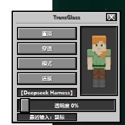

# TransGlass 使用教程

TransGlass 是一个 Windows 窗口透明化工具：给任意窗口做**逐窗透明度**、**鼠标/笔点透**、**置顶**，
再配一个 MC 风格的悬浮球当遥控器。

- 仓库：<https://github.com/railgun-1145/TransGlass>
- 下载：到 [Releases](https://github.com/railgun-1145/TransGlass/releases) 下最新的 `TransGlass_x.y.z_Setup.exe`

---

## 1. 安装

1. 双击 `TransGlass_<版本>_Setup.exe`
2. **安装位置可以自己改**（默认 `%LOCALAPPDATA%\Programs\TransGlass`，不需要管理员权限）
3. 可选：「开机自启」「创建桌面图标」
4. 装完自动启动，右下角托盘会出现一块**玻璃方块**图标

> 卸载：设置 → 应用 → TransGlass，或开始菜单里的卸载项。卸载会一并清掉开机自启项。

---

## 2. 主界面

左边是窗口列表（按虚拟桌面分组），右边是窗口卡片：

| 位置 | 作用 |
| :--- | :--- |
| 卡片标题 `【软件名】 窗口标题` | 一眼看出这是哪个程序的窗口 |
| 「透明」滑条 | 直接调这个窗口的透明度 |
| 「置顶」 | 该窗口是否总在最前 |
| 右键卡片 | 鼠标点透 / 笔点透 / 还原 等完整菜单 |
| 顶部「全部还原」 | 把所有被改过的窗口恢复原样 |
| 左下「设置」 | 打开设置页（不是弹窗，是同一窗口里切页） |
| 右下「小窗模式」 | 缩成 400×560 的小窗，常驻桌面角落 |

标题栏右上角有 **「帮助」**（就是打开这份文档）和最小化 / 最大化 / 关闭，关闭 = 收进托盘。

> 窗口最小化后会保留最小化前的**最后一帧**预览，并在卡片下方标「已最小化」（不会变回「无预览」）。
> Windows 不提供最小化窗口的画面，所以如果 TransGlass 启动时窗口已经最小化，只能显示「已最小化」占位；把它恢复一下再最小化就有图了。

---

## 3. 悬浮球

| 操作 | 效果 |
| :--- | :--- |
| 左键点纸娃娃 | 展开/收起面板 |
| **双击**纸娃娃 | 打开主界面（可在设置里关掉） |
| 拖动纸娃娃 | 把悬浮球挪到任意位置 |
| 面板「置顶 / 穿透 / 模式 / 还原」 | 对**当前目标窗口**生效 |
| 面板底部滑条 | 目标窗口透明度 |
| 面板左上【软件名】 | 当前遥控的是哪个软件 |
| 面板底部「最近输入」 | 刚才用的是鼠标还是笔 |
| 面板右上 **×** | 收起并隐藏悬浮球 |

隐藏之后想找回：**右键托盘玻璃图标 → 唤出悬浮球**，或到设置里勾上「显示悬浮球」。

---

## 4. 输入模式与设备（数位板）

设置 → **输入**：

- **输入模式**：`自动` / `强制鼠标` / `强制笔`。用 WinTab 驱动（Wacom/Huion 默认模式）的笔建议 `强制笔`。
- **输入设备**：三个下拉 —— 鼠标设备 / 笔设备 / 数位板。选好之后「自动」模式会**按设备**判断这一下是笔还是鼠标，
  驱动把笔上报成普通鼠标时也能正确触发「笔点透」。

---

## 5. 快捷键绑定

设置 → **快捷键**：

1. 点某一行的**按键格** → 变绿「按下按键…」
2. 直接按键盘组合或**鼠标键**（支持鼠标左键/右键/中键/侧键 1、2、滚轮上下）
3. `Esc` 取消；**右键点按键格**或点「清除」可以解绑
4. 改完点右下角「**保存并应用**」，立即生效不用重启

规则：鼠标左键/右键必须带修饰键（否则会抢掉正常点击）；重复的组合会标红。

> 主界面提示「某个键很可能被 XX 占用」时（比如 NVIDIA App 的游戏内叠加层默认占着 `Alt+R` 性能统计和 `Alt+Shift+R` 轮换指标），
> 可以直接换绑，或勾选上方的「**快捷键优先**」——它会用键盘钩子抢在其它软件前面生效，代价是那个键对其它软件也失效。

---

## 6. 设置里还有什么

- **窗口与预览**：预览帧率（0 = 关掉预览省 CPU）、小窗视图、实时小窗
- **悬浮球与纸娃娃**：皮肤、模型（经典/细）、大小、待机动画、显示开关、双击打开主界面
- **维护**：运行自检、检查更新、**开机自启动**、打开配置目录

---

## 7. 兼容说明

- **Photoshop / Illustrator / After Effects / Lightroom / Premiere / 画世界 / OBS / VLC / Office**
  这类 GPU 合成的重型应用，改透明度后会强制重绘一次，避免留旧帧（已实测 Photoshop 2023）。
- 托盘图标右键可唤回悬浮球；关闭主窗口只是收进托盘，真正退出请用托盘菜单「退出程序」。
- 所有改动只作用于**你选中/指到的那个窗口**，不会全局改系统设置。

---

## 8. 常见问题

**Q：改了透明度没反应？**
A：部分应用自身会重绘窗口样式，先点一下那个窗口再拖滑条；仍不行就点「还原」重新控制一次。

**Q：笔点透不生效？**
A：设置 → 输入里把「笔设备」选成你的数位板，或临时切「强制笔」。

**Q：悬浮球不见了？**
A：托盘图标右键 → 「唤出悬浮球」；或设置里勾「显示悬浮球」。
